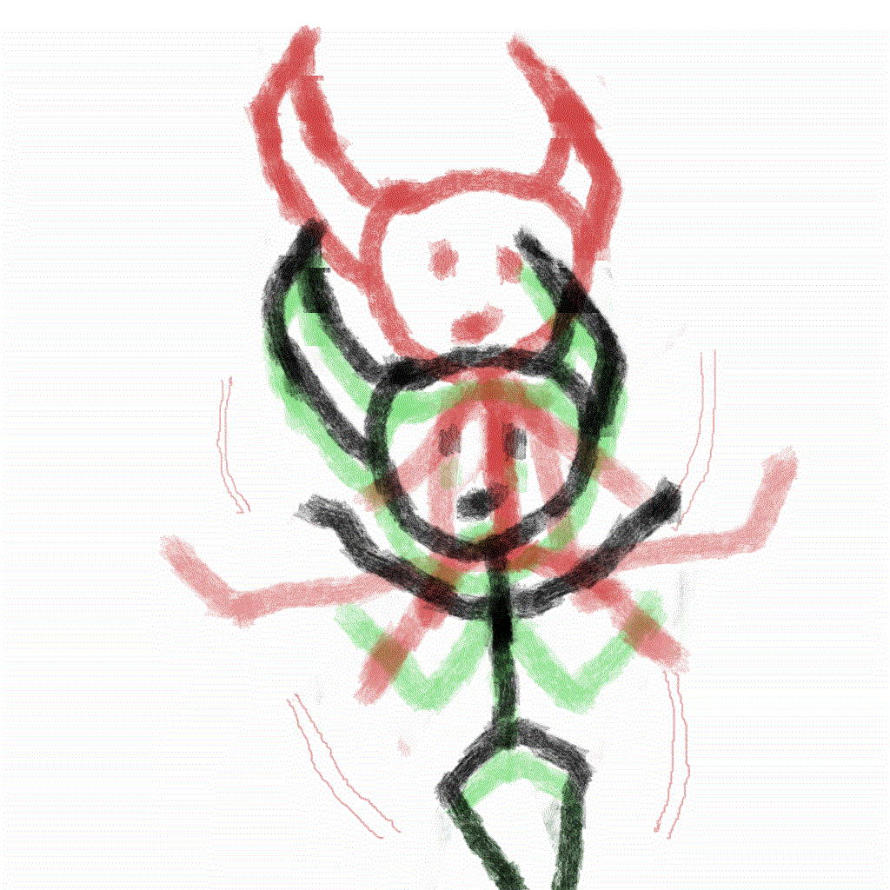

# 
hi, it's leslie

just a ce student, i dont like labels. 

 im interested in software engineering and computer systems and 
i like understanding what's happening under all those abstractions, otherwise i dont feel like im actually learning something. i like drawing for games too.

### languages
`lua` for games, `java` for everything else

### what im working on rn

-- currently, experimenting with socket programming in java through [linkzip](https://github.com/a-mammadova/linkzip)

-- researching on computer systems overall

### projects

-- [ring](https://github.com/a-mammadova/ring) - a location based remindere app (java, spring boot)

-- [slot-machine](https://github.com/a-mammadova/slot-machine) - your favorite terminal gamble game (java)

-- [bad-game](https://github.com/a-mammadova/bad-game) - a 2d stealth-action game (built with love & lua)

-- [ai-career-prep](https://github.com/a-mammadova/ai-career-prep) - a program that generates interview q&a for vacancies and identifies skill gaps between applicant's CV and job requirements. check abyss widget [here](https://abysshub.com/widgets/290/ai-career-preparation)
  
### contacts

[linkedin](https://linkedin.com/in/mammadovaasmar)
[mail](mammadovaasmar@outlook.com)
[artstation](https://www.artstation.com/leslimi)

